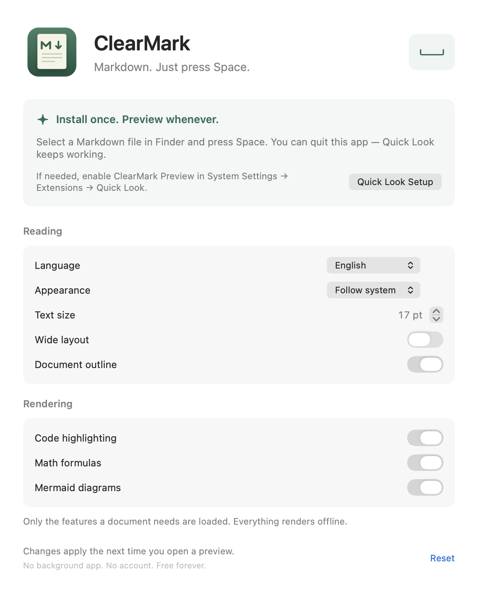

<p align="center"></p>
<h1 align="center">ClearMark</h1>
<p align="center">Install once. Press Space.<br>A lightweight, free Markdown Quick Look extension for macOS.</p>
<p align="center"><a href="README.zh-CN.md">简体中文</a> · <a href="https://github.com/Y2Data/md-previewer/releases">Download PKG</a> · <a href="LICENSE">MIT license</a></p>

Select a Markdown file in Finder and press **Space**. ClearMark renders it right in Quick Look. Open the app only to change settings, then quit it. There is no background app, login item, account, subscription, or expiration.

## Install

Requires **macOS 14+**, on Apple silicon or Intel.

1. Download the `.pkg` and its SHA-256 checksum from [GitHub Releases](https://github.com/Y2Data/md-previewer/releases).
2. Install it. The app and its bundled Quick Look extension go into `/Applications/ClearMark.app`.
3. If macOS requires it, open ClearMark → **Quick Look Setup**, then enable **ClearMark Preview** under Extensions → Quick Look. On recent macOS versions, this is in General → Login Items & Extensions.
4. Select a `.md` file in Finder and press **Space**. ClearMark does not need to remain open.

**Beta 2 includes a Developer ID Installer-signed PKG with a trusted timestamp.** The app and Quick Look extension are Developer ID Application-signed. **Apple notarization is still pending**, so macOS may block installation or require explicit approval. See the [signing and notarization procedure](docs/SIGNING.md).

If another Markdown Quick Look extension is installed, macOS may choose it until you disable it. Finder registration and extension approval are managed by macOS.

## Configure once



- English and Simplified Chinese, with automatic system-language selection.
- System, light, dark, and paper appearance; text size and page width.
- A collapsible document outline inside Quick Look.
- Optional syntax highlighting, KaTeX math, and Mermaid diagrams.
- GitHub-style tables, task lists, callouts, and one-click code copying.

Settings are stored locally in a shared app-group container and read when the next preview opens. Closing the settings window exits the app.

## Small by design

The host app contains only the native SwiftUI settings interface. The renderer and its assets are bundled **once**, inside the Quick Look extension. WebKit is supplied by macOS; no browser engine is shipped with the app.

Ordinary Markdown loads only the Markdown parser, sanitizer, and page styles. Code highlighting, math, fonts, and diagrams load only when the document needs them and the corresponding option is enabled. No runtime downloads are required. macOS controls the extension process’s lifetime and may cache it between previews.

## Local and bounded

Document HTML is sanitized. A Content Security Policy, URL filtering, and navigation policy block scripts from documents and remote resources. External links open in your browser only when clicked. The extension uses a nonpersistent WebKit data store.

Local images must be inside the document’s folder or its subfolders and accessible to the Quick Look sandbox. Parent traversal and symlink escapes are rejected. Remote images receive a placeholder.

Limits: 8 MB per document; 12 MB per local image; a 32 MB / 100-image input budget; raster thumbnails up to 2,048 pixels per edge and 24 megapixels total; 1 MB per local SVG; 12 diagrams of 12,000 characters each. Animations display their first frame. Broken diagrams keep their source visible.

UTF-8 and BOM-marked UTF-16 are supported. MDX is treated as Markdown without executing JSX. Front matter is hidden rather than interpreted. The settings app has no network entitlement; the extension has the entitlement macOS needs to start WebKit’s helper processes, while the renderer enforces offline operation.

## Build and test

Xcode 16+ is required. The generated project is checked in. XcodeGen and Node are not needed to build the app.

```sh
xcodebuild -project ClearMark.xcodeproj -scheme ClearMark \
  -destination 'platform=macOS' -derivedDataPath build/Tests \
  CODE_SIGN_IDENTITY=- CODE_SIGN_STYLE=Manual test
```

For a distributable app with settings shared across the sandbox boundary, sign both targets with the same Developer ID team and app group. See [SIGNING.md](docs/SIGNING.md). Ad-hoc builds are useful for development and renderer tests; they do not establish distribution signing or app-group access.

After changing target membership, regenerate the project with `xcodegen generate`.

```sh
npm ci
npx playwright install chromium
npm test
python3 scripts/verify-vendor.py
```

Tests cover native document limits and path containment, persisted settings, both UI languages and layouts, real WebKit rendering, malicious HTML, offline operation, on-demand loading, and render races. The browser suite also captures preview screenshots. Native UI screenshots come from the XCTest attachment export.

An optional [GitHub Actions template](docs/github-actions.yml) can be copied to `.github/workflows/checks.yml`. The current publishing token does not have the `workflow` scope.

## Package

```sh
python3 scripts/package-release.py \
  --app build/Distribution/Build/Products/Release/ClearMark.app \
  --output build/releases/beta
```

This creates a beta PKG and checksum without install scripts, launch agents, or background services. The same script supports installer signing, Apple notarization, and stapling when the required identities and keychain profile are supplied.

## License

[MIT](LICENSE). Bundled library versions and licenses are listed in [THIRD_PARTY_NOTICES.md](THIRD_PARTY_NOTICES.md); their asset hashes are recorded in `ClearMark/Resources/Vendor/manifest.json`.
