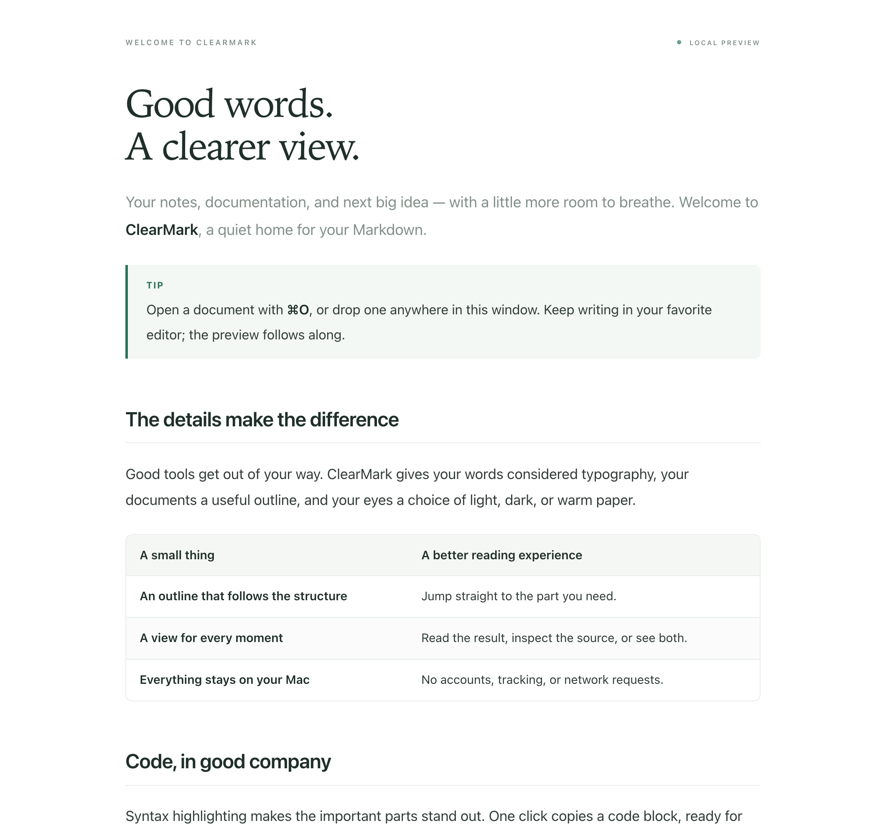

<p align="center"></p>
<h1 align="center">ClearMark</h1>
<p align="center">Good words. A clearer view.<br>A free, offline Markdown reader and Finder Quick Look extension for macOS.</p>
<p align="center"><a href="LICENSE">MIT licensed</a> · macOS 14+ · SwiftUI + WebKit · No account required</p>

ClearMark gives Markdown a comfortable place to be read. Open a file, keep writing in your preferred editor, and watch the preview update. Use the outline to get around, switch to source or split view, and export when you’re ready to share.

<picture>
  <source media="(prefers-color-scheme: dark)" srcset="docs/reader-dark.png">
  
</picture>

## What’s here

- Native macOS window with outline navigation, recent documents, drag and drop, and keyboard shortcuts.
- Finder Quick Look extension using the same renderer as the app.
- Live reload, including files replaced by an editor’s atomic save.
- Read, split, and selectable source views; document search; word count and reading time.
- System, light, dark, and paper themes; adjustable text size and page width.
- GitHub-style tables, task lists, strikethrough, and callouts.
- Syntax highlighting with a copy button, KaTeX math, and Mermaid diagrams.
- PDF export, native printing, and script-free standalone HTML with native MathML.
- Bundled rendering libraries. No accounts, telemetry, subscription, or runtime downloads.

## Build and run

Requires **macOS 14 or later** and **Xcode 16 or later**. The generated Xcode project is checked in; XcodeGen and Node are not needed to build the app.

```sh
git clone https://github.com/Y2Data/md-previewer.git
cd md-previewer
xcodebuild -project ClearMark.xcodeproj -scheme ClearMark \
  -configuration Release -destination 'platform=macOS' \
  -derivedDataPath build CODE_SIGN_IDENTITY=- CODE_SIGN_STYLE=Manual build
open build/Build/Products/Release/ClearMark.app
```

Or open `ClearMark.xcodeproj`, select the **ClearMark** scheme, and run. Choose your signing team in both targets if you want to use your own development certificate. The command above uses a local ad-hoc signature and requires no paid developer account.

This is an early source release. There is no Developer ID signed, notarized download yet. Build locally to try it. A distributable release needs both the app and its extension signed by the same team, followed by notarization.

## Finder Quick Look

1. Build the app and copy `ClearMark.app` to your Applications folder.
2. Launch ClearMark once.
3. Enable **ClearMark Preview** in System Settings → General → Login Items & Extensions → Quick Look. On older macOS versions, look under Privacy & Security → Extensions.
4. Select a `.md` file in Finder and press **Space**.

If another Markdown preview extension is installed, macOS may keep using it until you disable it. Extension activation depends on macOS registration and signing; a successful compile alone does not verify Finder activation.

## Shortcuts

| Action | Shortcut |
| --- | --- |
| Open document | ⌘O |
| Find / next / previous | ⌘F / ⌘G / ⇧⌘G |
| Read / Split / Source | ⌘1 / ⌘2 / ⌘3 |
| Increase / decrease / reset text size | ⌘+ / ⌘− / ⌘0 |
| Export PDF | ⇧⌘E |
| Copy Markdown | ⇧⌘C |
| Print | ⌘P |

## Local files and privacy

Markdown is treated as untrusted input: DOMPurify sanitizes the HTML, a Content Security Policy blocks network access and document scripts, and WebKit uses a nonpersistent data store. The app and extension are sandboxed. External links open in your default browser only when you click them.

The targets include the outgoing-network entitlement because macOS requires it to launch WebKit’s helper processes, even for local content. The renderer’s CSP, URL rewriting, and navigation delegate enforce the offline policy; the browser tests check that document content makes no external requests.

Remote images are deliberately replaced with a placeholder. Local images are limited to the document’s own folder and its subfolders; parent traversal and symlink escapes are rejected. If the macOS sandbox blocks an image, choose **File → Allow Images from Folder…** and select the document’s containing folder. Quick Look has no folder picker and can only show images accessible to its sandbox.

Documents are limited to 8 MB, local images to 12 MB each and a 32 MB / 100-image budget, and diagrams to 12 blocks of 12,000 characters. Raster images are thumbnailed to a maximum edge of 2,048 pixels with a total 24-megapixel budget; animations display their first frame. Local SVG files are limited to 1 MB. Oversized or malformed diagrams show their source. UTF-8 and BOM-marked UTF-16 are supported. Recent file bookmarks and reading preferences stay in local app preferences.

ClearMark is a reader, not an editor. `.mdx` files are shown as Markdown without executing JSX. YAML front matter is hidden rather than interpreted. Arbitrary HTML styling, interactive embeds, executable code, and remote resources are not supported.

PDF export preserves the current reading appearance as one continuous page. Use **File → Print** for the system’s paginated print workflow. HTML export embeds loaded local images; unavailable or not-yet-loaded images receive a placeholder.

## Development

`project.yml` is the source for the Xcode project. After changing targets or file lists, regenerate it with [XcodeGen](https://github.com/yonaskolb/XcodeGen):

```sh
xcodegen generate
```

Run the native document/security tests and the real WebKit rendering test:

```sh
xcodebuild -project ClearMark.xcodeproj -scheme ClearMark \
  -destination 'platform=macOS' -derivedDataPath build \
  CODE_SIGN_IDENTITY=- CODE_SIGN_STYLE=Manual test
```

The optional browser suite checks the renderer, malicious HTML, network isolation, heading collisions, malformed diagrams, concurrent reloads, and HTML export. Node is only used for these development checks:

```sh
npm install
npx playwright install chromium
npm test
python3 scripts/verify-vendor.py
```

The app icon is generated from native drawing code in `scripts/make-icon.swift`. Renderer screenshots are captured by the browser test; they show the reading surface, not the native window chrome.

## Architecture

| Location | Responsibility |
| --- | --- |
| `ClearMark/App` | SwiftUI interface, file access, reload, search, export |
| `ClearMark/Shared` | Bounded file reads, local resource handling, WebKit bridge |
| `ClearMark/Resources` | Shared offline renderer, styles, sample, vendored libraries |
| `QuickLook` | Finder preview extension |
| `Tests/Swift` | Native file/security and WebKit integration tests |
| `scripts/browser-smoke.cjs` | Browser regression checks and screenshots |

## License

ClearMark is [MIT licensed](LICENSE). The bundled libraries retain their own licenses in [Vendor/Licenses](ClearMark/Resources/Vendor/Licenses). See [THIRD_PARTY_NOTICES.md](THIRD_PARTY_NOTICES.md) for versions and attribution.
