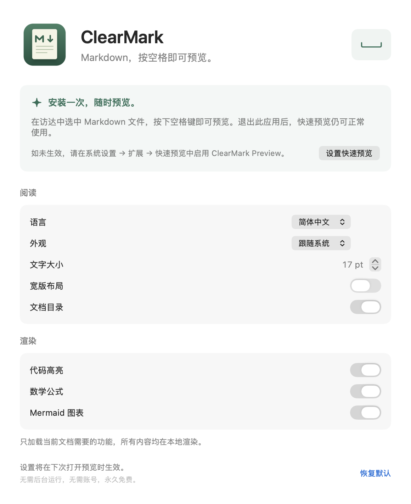

# ClearMark

**安装一次，按空格即可预览。** 免费、轻量的 macOS Markdown 快速预览扩展。

[English](README.md) · [下载 PKG 安装包](https://github.com/Y2Data/md-previewer/releases) · [MIT 开源协议](LICENSE)

在访达中选中 Markdown 文件，按下 **空格键**，即可直接预览。应用本体只负责设置；设置完即可退出，不需要常驻后台、登录项、账号或订阅，也没有使用期限。

## 安装

支持 **macOS 14 及以上**，同时兼容 Apple 芯片和 Intel Mac。

1. 从 [GitHub Releases](https://github.com/Y2Data/md-previewer/releases) 下载 `.pkg` 和对应的 SHA-256 校验文件。
2. 安装后，主程序和快速预览扩展位于 `/Applications/ClearMark.app`。
3. 如未生效，打开 ClearMark，点击“设置快速预览”，在系统设置的“扩展 → 快速预览”中启用 **ClearMark Preview**。较新系统的入口位于“通用 → 登录项与扩展”。
4. 回到访达，选中 `.md` 文件并按空格。之后无需保持 ClearMark 运行。

**首个 PKG 为安装包尚未签名、未经 Apple 公证的测试版。** 应用本体的签名状态会在发布说明中单独列出。macOS 可能要求你明确允许后才能安装下载的测试包。正式版所需的[签名、公证与发布流程](docs/SIGNING.md)已准备好，后续补齐安装包证书和公证配置即可执行。

如果已有其他 Markdown 快速预览扩展，macOS 可能优先使用它；可在系统设置中停用冲突的扩展。扩展注册和启用由 macOS 管理。

## 只在需要时打开设置



- 英文、简体中文，可跟随系统语言。
- 跟随系统、浅色、深色、纸张四种外观。
- 文字大小、宽版布局、可折叠的文档目录。
- 可选的代码高亮、数学公式与 Mermaid 图表。
- 支持表格、任务列表、提示块，以及一键复制代码。

设置保存在本机共享应用组容器中，下次打开预览时读取。关闭设置窗口后，主程序会退出。

## 轻量、离线

主程序只有原生 SwiftUI 设置界面。渲染器及资源只在扩展中保留一份，直接使用 macOS 自带的 WebKit，不内置浏览器引擎。

普通文档只加载 Markdown 解析器、内容清理器和样式。只有文档实际包含代码、数学或图表，而且对应功能已开启时，才加载所需资源。所有资源随安装包提供，无需联网下载。扩展进程的生命周期由 macOS 管理，系统可能在两次预览之间保留缓存。

文档中的脚本和远程资源会被阻止。只有点击外部链接时才会打开浏览器。本地图片必须位于文档文件夹或其子文件夹内，并且能被快速预览沙盒访问；不允许越界路径和符号链接逃逸。

为保持预览流畅，文档上限为 8 MB。图片有文件大小、数量和总像素预算，大图会缩小；图表也有数量和长度限制。详细限制见 [英文说明](README.md#local-and-bounded)。

## 开发与打包

需要 Xcode 16 或更新版本。仓库已包含 Xcode 工程；构建应用不需要 Node。原生测试涵盖设置持久化、中英文界面、真实 WebKit 渲染和文件安全限制；浏览器测试涵盖按需加载、离线策略、恶意 HTML 和并发渲染。

```sh
xcodebuild -project ClearMark.xcodeproj -scheme ClearMark \
  -destination 'platform=macOS' -derivedDataPath build/Tests \
  CODE_SIGN_IDENTITY=- CODE_SIGN_STYLE=Manual test
```

正式分发时，应用与扩展需要使用同一 Developer ID 团队和应用组签名。请参阅[签名说明](docs/SIGNING.md)。临时签名构建可用于开发测试，不代表已完成分发签名或应用组授权。

[打包脚本](scripts/package-release.py)支持生成测试版 PKG，也支持后续的安装包签名、Apple 公证和票据装订。安装包不包含安装脚本、登录项或后台服务。

项目采用 [MIT 协议](LICENSE)。第三方库及其协议见 [THIRD_PARTY_NOTICES.md](THIRD_PARTY_NOTICES.md)。
